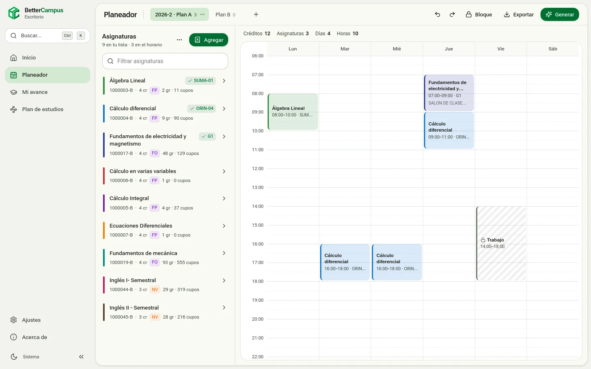
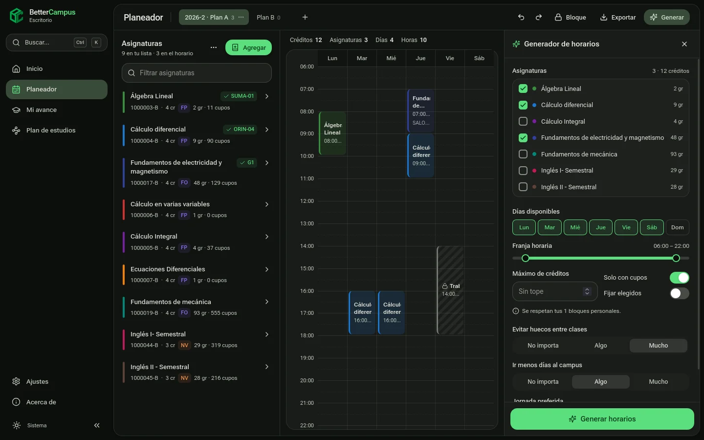
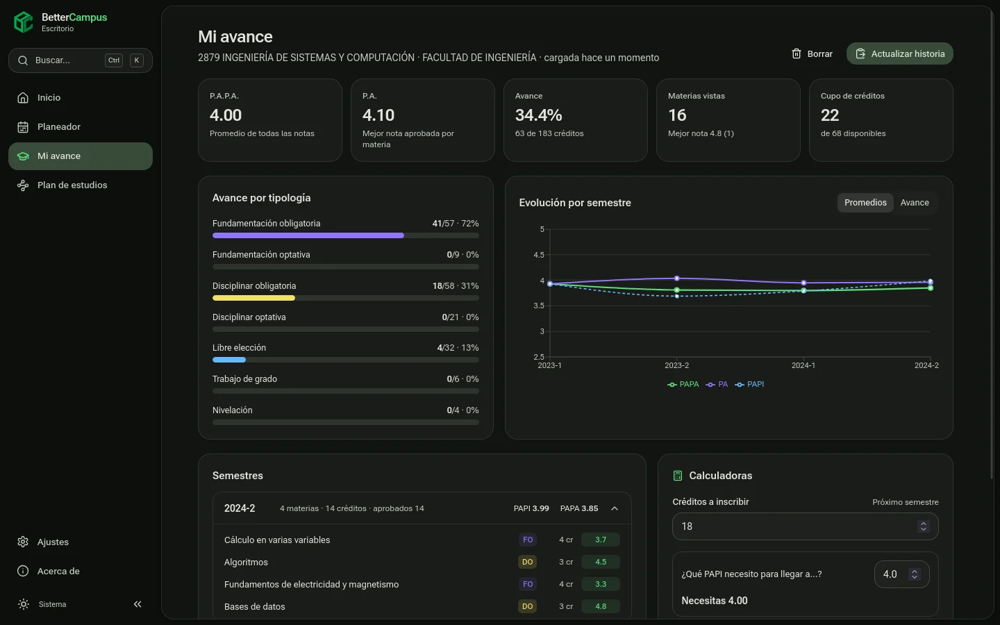
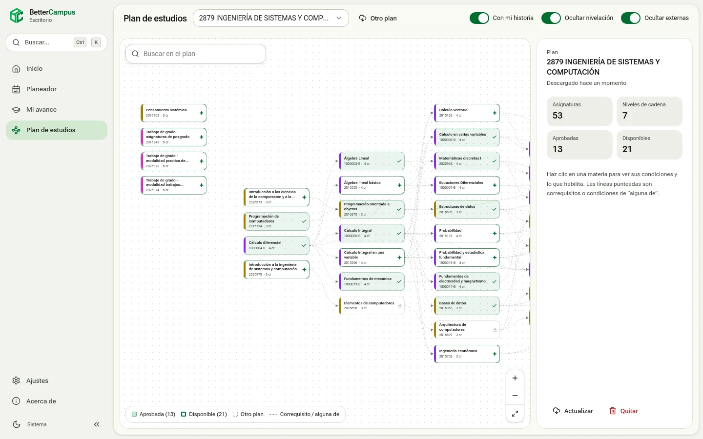
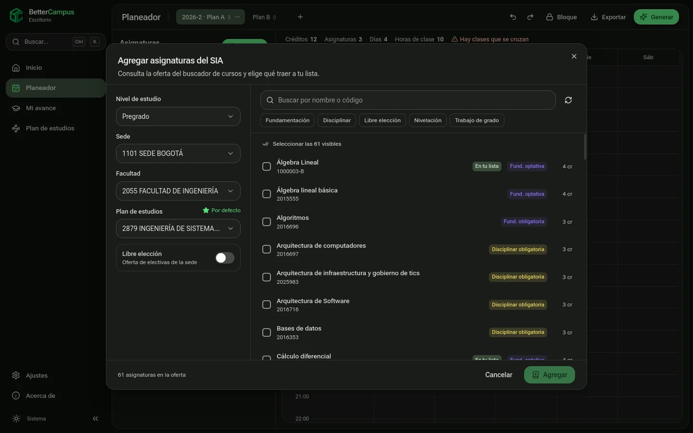

<div align="center">


# BetterCampus Desktop

**Planea tu semestre en la Universidad Nacional sin abrir diez pestañas del SIA.**

[](https://github.com/Camilo-neck/BCDesktop/actions/workflows/ci.yml)
[](https://github.com/Camilo-neck/BCDesktop/releases)
[](LICENSE)


[Descargar](https://github.com/Camilo-neck/BCDesktop/releases/latest) · [Contribuir](CONTRIBUTING.md) · [Arquitectura](docs/ARCHITECTURE.md) · [Reportar un problema](https://github.com/Camilo-neck/BCDesktop/issues/new/choose)

</div>



BetterCampus consulta la oferta del SIA, arma tu horario sin choques, analiza tu historia académica y dibuja el mapa de prerrequisitos de tu carrera. Es la versión de escritorio de [bettercampus.com.co](https://bettercampus.com.co), y **todo se calcula en tu computador**: no necesitas cuenta y tus datos no pasan por ningún servidor.

## Funciones

- **Planeador**: busca materias por nivel, sede, facultad y plan, o en la oferta de libre elección. Ves grupos, cupos, profesores y salones, y los choques aparecen antes de agregar un grupo. Puedes tener varios horarios, bloques personales (trabajo, transporte), favoritos, colores y deshacer/rehacer.
- **Generador**: prueba todas las combinaciones sin choques que respetan tus días, franja horaria, tope de créditos y cupos. Las ordena por huecos, días en el campus y jornada preferida.
- **Mi avance**: pega el texto de tu historia académica y obtén P.A.P.A., P.A., avance por tipología, evolución por semestre y calculadoras («¿qué PAPI necesito?»).
- **Plan de estudios**: el grafo de prerrequisitos de tu carrera. Con tu historia cargada, marca lo aprobado y lo que ya puedes inscribir.
- **Exportar** el horario a Google Calendar o a un archivo `.ics` (Outlook, Apple Calendar).
- **Profesores**: reseñas de LosEstudiantes e historial de cómo se agotan los cupos de cada grupo.
- Tutorial guiado la primera vez que usas cada función, paleta de comandos (`Ctrl K`) y tema claro/oscuro.
- **Actualizaciones**: la app avisa cuando hay una versión nueva y se actualiza sola. También puede instalarlas automáticamente al cerrarse.

<table>
  <tr>
    <td></td>
    <td></td>
  </tr>
  <tr>
    <td></td>
    <td></td>
  </tr>
</table>

## Instalación

Descarga el instalador para tu sistema en [Releases](https://github.com/Camilo-neck/BCDesktop/releases/latest):

| Sistema | Archivo |
| --- | --- |
| Windows 10/11 | `BetterCampus_x.y.z_x64-setup.exe` |
| macOS 11+ | `BetterCampus_x.y.z_universal.dmg` |
| Linux | `.AppImage`, `.deb` o `.rpm` |

Los instaladores todavía no están firmados. La primera vez, Windows muestra «Windows protegió su PC»: elige *Más información › Ejecutar de todas formas*. En macOS, abre la app con clic derecho › *Abrir*.

Desde la versión 0.2.0 no hace falta volver a descargar el instalador: la app busca versiones nuevas al abrirse y se actualiza desde *Ajustes › Actualizaciones*.

## Desarrollo

### Requisitos

- [Rust](https://rustup.rs) estable, Node 20 o superior y npm.
- **Linux**: WebKitGTK 4.1 y las librerías de Tauri.
  - Arch: `sudo pacman -S --needed webkit2gtk-4.1 base-devel curl wget file openssl appmenu-gtk-module libappindicator-gtk3 librsvg`
  - Debian/Ubuntu: `sudo apt install libwebkit2gtk-4.1-dev build-essential curl wget file libxdo-dev libssl-dev libayatana-appindicator3-dev librsvg2-dev libdbus-1-dev`
- **Windows**: [Build Tools de Visual Studio](https://visualstudio.microsoft.com/visual-cpp-build-tools/) con «Desarrollo para el escritorio con C++». WebView2 ya viene con Windows 10/11.
- **macOS**: `xcode-select --install`.

### Comandos

```bash
npm install
npm run app:dev          # app completa con recarga en caliente
npm run dev              # solo la interfaz en el navegador, con datos de ejemplo reales
npm run app:build        # instaladores del sistema actual en target/release/bundle/
```

```bash
cargo test -p bc-core                                   # pruebas del núcleo
cargo run -p bc-core --example sia_live                 # recorrido real contra el SIA
cargo run -p bc-core --example sia_prereqs -- 0-2-8-4   # prerrequisitos de un plan completo
npm run typecheck
```

### Estructura

```
BCDesktop/
├── crates/bc-core/      Núcleo en Rust: SIA, generador, historia, grafo, integraciones, SQLite
├── src-tauri/           App Tauri: comandos y estado
├── src/                 Interfaz React (pages/, components/, lib/, dev/)
├── docs/                Arquitectura, publicación de versiones y capturas
└── .github/             CI, releases y plantillas
```

| Capa | Tecnología |
| --- | --- |
| Escritorio | [Tauri 2](https://tauri.app) |
| Interfaz | React 19, Vite, Tailwind CSS 3, Radix UI, Recharts, Motion |
| Estado | TanStack Query y Zustand |
| Núcleo | Rust (`reqwest`, `scraper`, `regex`, `rusqlite`) |

La [guía de arquitectura](docs/ARCHITECTURE.md) explica cómo se habla con el SIA, cómo funciona el generador y qué guarda la base de datos local.

## Configuración

Las integraciones externas se configuran **al compilar**, con variables de entorno. El estudiante no tiene que configurar nada. Si falta una variable, la función correspondiente aparece como no disponible.

| Variable al compilar | Para qué |
| --- | --- |
| `BC_GOOGLE_CLIENT_ID`, `BC_GOOGLE_CLIENT_SECRET` | Exportar a Google Calendar |
| `BC_STATS_API_URL` | Histórico de cupos (`POST {url}/InscriptionStats/`) |

**Google Calendar**: en Google Cloud Console crea un cliente OAuth de tipo **App de escritorio** y habilita la Google Calendar API. La app usa un redirect local (`http://127.0.0.1:<puerto>`) con PKCE y solo pide el alcance `calendar.app.created`, así que solo puede ver los calendarios que ella misma crea. El token se guarda en el llavero del sistema.

> **TO-DO:** los releases oficiales todavía no incluyen estas credenciales, así que Google Calendar y el histórico de cupos aún no funcionan en los instaladores publicados. El detalle está en [docs/RELEASING.md](docs/RELEASING.md#pendiente-para-versiones-futuras).

## Contribuir

Las contribuciones son bienvenidas: código, reportes de bugs, avisos de cambios en el SIA, ideas y documentación. Lee la [guía de contribución](CONTRIBUTING.md) y el [código de conducta](CODE_OF_CONDUCT.md). Para vulnerabilidades, sigue la [política de seguridad](SECURITY.md).

Los cambios de cada versión están en el [CHANGELOG](CHANGELOG.md), y el proceso para publicar una versión, en [docs/RELEASING.md](docs/RELEASING.md).

## Aviso

BetterCampus es un proyecto estudiantil independiente y no está afiliado a la Universidad Nacional de Colombia. La información de asignaturas, grupos y cupos viene del buscador público del SIA y puede cambiar en cualquier momento: verifica siempre en el SIA antes de inscribir.

## Licencia

[PolyForm Noncommercial 1.0.0](LICENSE) © BetterCampus contributors

El código es público y puedes usarlo, estudiarlo, modificarlo y redistribuirlo con fines **no comerciales**. Cualquier uso con ánimo de lucro (vender el software o versiones derivadas, monetizarlo con anuncios, suscripciones, etc.) requiere autorización previa y por escrito de los mantenedores.
